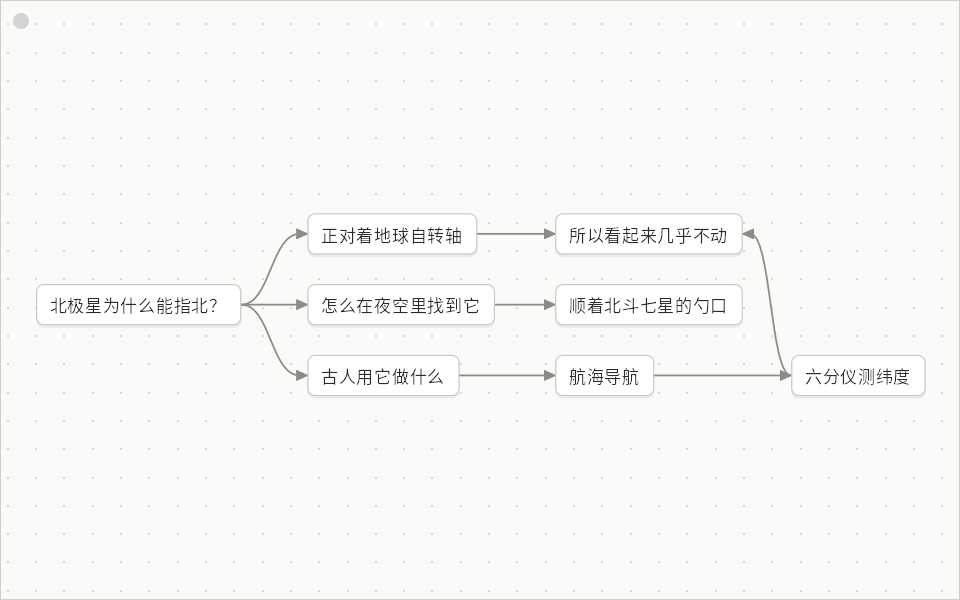
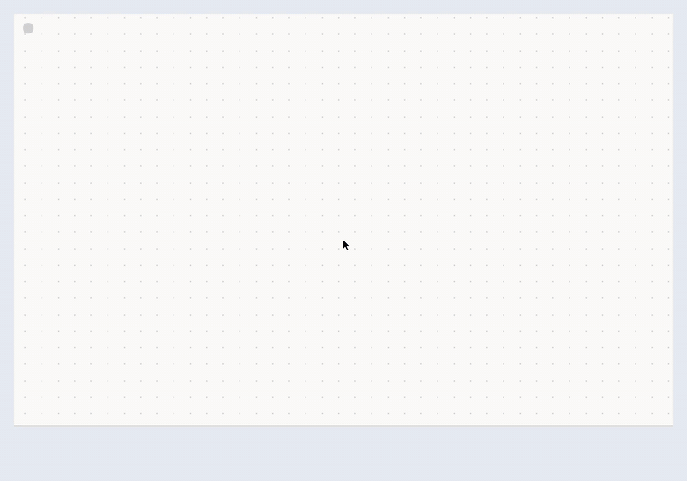
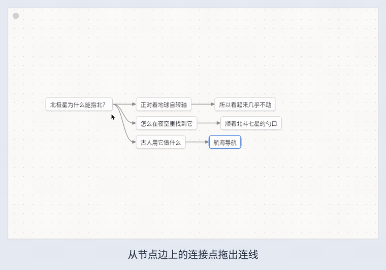
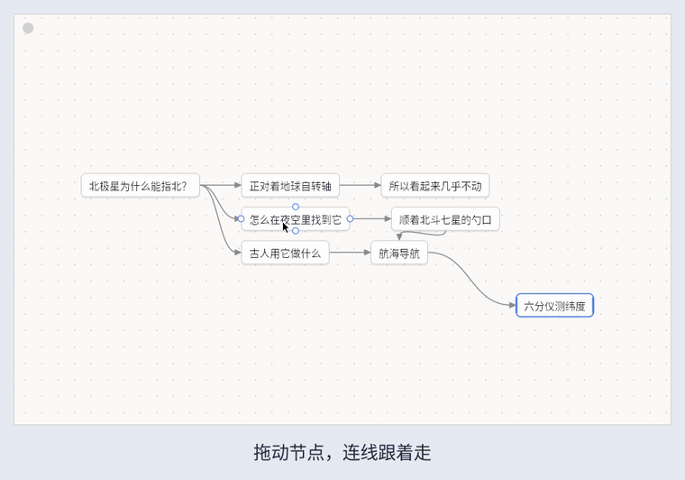
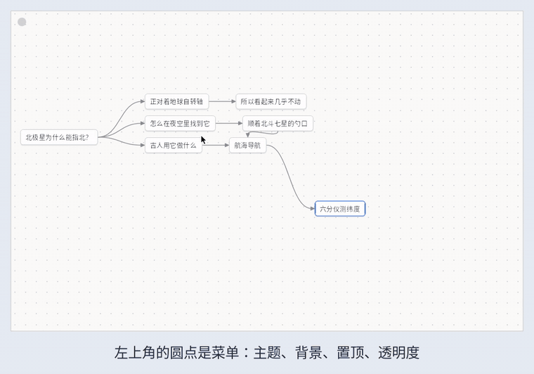
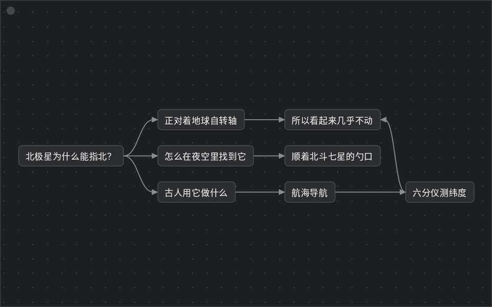

<p align="center">
  
</p>

<h1 align="center">Polaris · 北极星</h1>

<p align="center">
  查资料时的路线图：一块始终置顶的小画布，随手记下“从哪查到哪”。
</p>

<p align="center">
  <a href="https://github.com/Quiet66/Polaris/releases/latest"></a>
  
  <a href="LICENSE"></a>
  
</p>

> [!NOTE]
> **本项目由 AI 开发。** 全部代码、图标、文档和演示素材由 Anthropic 的 Claude（通过 Claude Code）编写；
> 需求规格、设计取舍和实机验收由作者 [峨眉峰dz](https://github.com/Quiet66) 完成。
> 详见下文[关于开发](#关于开发)。

<p align="center">
  
</p>

## 它解决什么问题

查资料很容易越走越远：从一篇文章点进一个名词，再跳到另一个页面，半小时后开了二十个标签页，
已经想不起自己是怎么走到这里的。

Polaris 是悬在屏幕一角的一块小画布。每查到一个点，就记一个节点；顺着线索往下走，按一下 Tab
就接上一条线。随时抬头，都能看清自己从哪来、走到了哪、还有哪几条岔路没走。

- **始终置顶、无边框**：不挡视线，透明度可调，整个窗口就是画布。
- **键盘优先**：双击建点，Tab 连续往下记，Enter 确认，几乎不用离开键盘。
- **存成 Markdown**：文件就是一份大纲，用记事本也能读，不被锁在软件里。
- **轻量离线**：解压即用，不联网、不安装、不写注册表，约 25 MB，老电脑也跑得动。

## 下载与运行

1. 到 [Releases](https://github.com/Quiet66/Polaris/releases/latest) 下载 `Polaris-v*-win32.zip`。
2. 解压到任意文件夹（例如 U 盘），双击 `polaris.exe`。

**系统要求**：Windows 7 SP1 及以上，32 位和 64 位都可以，不需要安装任何运行库。
目前作者在 Windows 11 上实测通过；Windows 7 / 10 尚未实机验证，欢迎反馈。

> [!TIP]
> 程序没有数字签名。第一次运行时如果出现“Windows 已保护你的电脑”，
> 点 **更多信息 → 仍要运行** 即可。

## 快速上手

### 1. 双击建点，按 Tab 一路往下记

双击空白处新建节点，输入文字。按 **Tab** 会以当前节点为起点再建一个，并自动连线；
选中某个节点再按 Tab，就从它分出一条新的岔路。



### 2. 从连接点拖出连线

鼠标移到节点上，四边会出现连接点。拖到另一个节点上就连一条线；拖到空白处松开，
会在那里新建一个节点并连好。



### 3. 拖动、缩放、平移

拖动节点时连线会跟着走；滚轮以光标为中心缩放；按住空格拖动画布。
拖动画布、拖动窗口用哪个键都可以在设置里改（例如改成右键拖动画布）。



### 4. 菜单：主题、背景、置顶、透明度

左上角的小圆点就是菜单：单击打开，拖动它可以移动窗口，双击最大化。



深色主题下的样子：



完整的操作演示（约 1 分钟）见 Releases 里的 `polaris-demo.mp4`。

## 操作一览

### 节点

| 操作 | 效果 |
|---|---|
| 双击空白处 | 新建节点并开始编辑 |
| 双击节点，或选中后按 F2 | 编辑文字 |
| 选中一个节点后按 Tab | 新建相连的节点（原节点 → 新节点） |
| 编辑时 Enter / Shift+Enter | 确认 / 换行 |
| 编辑时 Esc | 放弃这次修改 |
| 编辑时 Tab | 确认，并接着再建一个相连的节点 |
| 确认时文字为空 | 删除这个节点 |
| 拖动选中节点的左右两边 | 调整宽度，文字自动换行 |
| Ctrl + `=` / Ctrl + `-` / Ctrl + `0` | 放大 / 缩小 / 恢复选中节点的字号 |
| Delete 或 Backspace | 删除选中的节点，连同与它相连的线 |

### 连线

| 操作 | 效果 |
|---|---|
| 从连接点拖到另一个节点 | 连一条线（两个节点之间最多一条） |
| 从连接点拖到空白处 | 在那里新建节点并连线 |
| 单击连线后按 Delete | 只删这条线，两端的节点不受影响 |
| 菜单 → 连线方向 | 关掉后不画箭头，方向信息仍然保留 |

### 画布

| 操作 | 效果 |
|---|---|
| 滚轮 | 以光标为中心缩放（20% ～ 300%） |
| 空格 + 左键拖动，或中键拖动 | 平移画布（可改，见下文） |
| 在空白处拖动 | 框选 |
| Shift + 单击 | 加选 / 减选 |
| Ctrl+A | 全选 |
| Ctrl+1 | 缩放到能看见全部节点 |
| Ctrl+Z / Ctrl+Y | 撤销 / 重做（一次拖动算一步，最多 200 步） |

### 文件

| 快捷键 | 效果 |
|---|---|
| Ctrl+N / Ctrl+O | 新建 / 打开 |
| Ctrl+S / Ctrl+Shift+S | 保存 / 另存为 |
| 菜单 → 导出图片 | 导出 PNG（在“保存类型”里选带背景或透明背景） |

内容有改动时会自动存一份草稿。程序意外关闭后，下次启动会询问是否恢复。

### 窗口

| 操作 | 效果 |
|---|---|
| 拖动左上角圆点 | 移动窗口 |
| Alt + 左键拖动画布任意处 | 移动窗口（可改，见下文） |
| 双击左上角圆点 | 最大化 / 还原 |
| 拖动窗口边缘 | 调整大小 |
| Alt+F4 或关闭窗口 | 收进托盘，程序仍在运行 |
| 菜单 → 退出 | 真正退出 |
| 单击托盘图标 | 显示 / 隐藏窗口 |

### 全局快捷键（在任何程序里都有效）

| 快捷键 | 效果 |
|---|---|
| Ctrl+Alt+Space | 隐藏 / 唤出窗口 |
| Ctrl+Alt+T | 切换窗口置顶 |
| Ctrl+Alt+↑ / ↓ | 透明度增减 10%（最低 30%） |

### 改成自己顺手的方式

菜单 → **快捷键与鼠标设置**：

- **拖动画布**：空格+左键（默认）、右键、中键、Ctrl+左键、Alt+左键
- **拖动窗口**：Alt+左键（默认）、Ctrl+左键、右键、中键、空格+左键，或不启用
- 上面四个全局快捷键

菜单里还可以切换背景（纯色 / 点阵 / 线阵）、主题（浅色 / 深色）、连线方向、精简动效、
窗口置顶和透明度。所有设置都会被记住。

## 文件格式：存成 Markdown

文件保存为 `.md`，用任何文本编辑器打开都能直接读：

```markdown
# 北极星

- 北极星为什么能指北？
  - 正对着地球自转轴
    - 所以看起来几乎不动
  - 怎么在夜空里找到它
    - 顺着北斗七星的勺口
  - 古人用它做什么
    - 航海导航
      - 六分仪测纬度

## 其他关联

- 六分仪测纬度 → 所以看起来几乎不动

<!-- polaris:{"version":1, ...} -->
```

大纲按连线自动生成；不在树上的交叉连线列在“其他关联”里。最后一行注释是 Polaris
还原画面用的布局信息，**请不要改动或删除它**，否则 Polaris 将无法再打开这个文件。

## 设置与数据

- 设置和草稿保存在程序文件夹下的 `data\` 里。该位置不能写入时，改存到 `%APPDATA%\Polaris`。
- 想恢复初始状态：退出 Polaris，删掉 `data` 文件夹即可。
- 整个文件夹拷到别的电脑或 U 盘，设置会跟着走。
- 程序卡住或崩溃时，`data\` 里会出现 `hang.log` 或 `crash.log`，只含时间和技术数字，
  不含你的内容。反馈问题时附上它们会很有帮助。

## 常见问题

**关掉窗口后程序还在运行？**
是的，关闭只是收进托盘，方便随时用 Ctrl+Alt+Space 唤出。要退出请用菜单里的“退出”。

**双击 `polaris.exe` 没反应？**
Polaris 同时只运行一个。如果它已经在托盘里，再次启动会把原来的窗口唤出来，而不是开新窗口。

**某个全局快捷键不起作用？**
可能被别的软件占用了，启动时会有提示。到“快捷键与鼠标设置”里换一个组合即可。

**用别的软件改过的 `.md` 能打开吗？**
只要末尾那行布局注释还在，就能打开（会忽略正文的改动）。没有布局注释的 Markdown 暂时不支持导入。

## 已知限制

- 菜单里的“对齐吸附”开关目前还没有实际效果（计划中的功能）。
- 不能导入没有布局注释的 Markdown（计划中）。
- 只支持 Windows。

## 关于开发

Polaris 是一次 AI 辅助开发的实践：

- **AI 负责**：全部 C++ 代码、构建与打包脚本、测试、图标、使用说明、演示视频与动图，
  均由 Anthropic 的 Claude 通过 Claude Code 编写和制作。开发和自动化测试是在 Linux 容器里
  通过 Wine 运行原版 Windows 工具链（Qt 5.15.2 + MinGW 8.1）完成的。
- **作者负责**：提出需求规格（见 [SPEC.md](SPEC.md)）、做设计取舍、在 Windows 上实机验收并反馈问题。

想自己编译或修改代码，请看 [开发说明](docs/DEVELOPMENT.md)。

## 许可证

Polaris 以 [MIT 许可证](LICENSE) 发布，Copyright © 2026 峨眉峰dz。

程序包里附带的 Qt 5.15.2（LGPL v3）和 MinGW-w64 运行库各有其许可证，
说明见 [packaging/THIRD-PARTY.txt](packaging/THIRD-PARTY.txt)。
